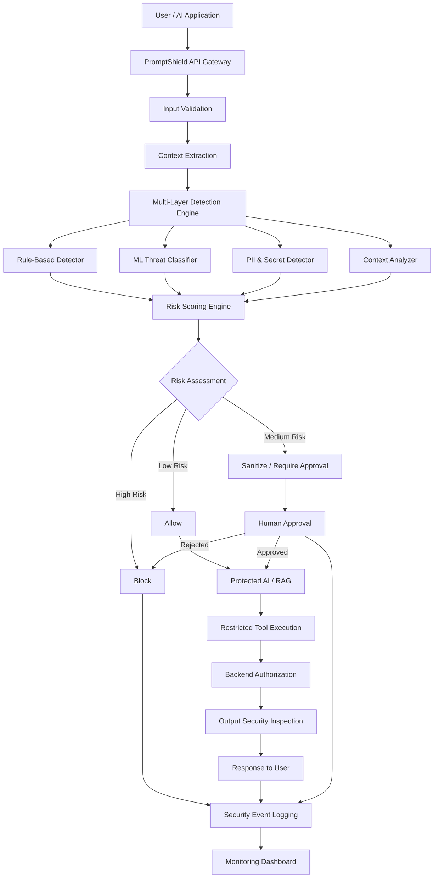
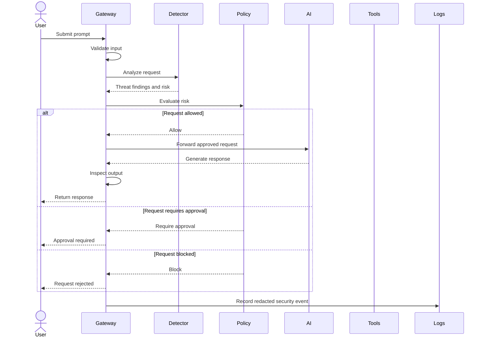

# PromptShield AI — System Architecture

## 1. High-Level Architecture

## 2. Request Processing Workflow

## 3. Core Modules

| Module | Responsibility |
|---|---|
| API Gateway | Accept and validate incoming requests |
| Rule Detector | Identify known malicious patterns |
| ML Classifier | Classify potentially malicious prompts |
| Privacy Detector | Identify PII and secrets |
| Context Analyzer | Inspect trust boundaries and retrieved content |
| Risk Engine | Calculate combined risk |
| Policy Engine | Decide allow, sanitize, approval or block |
| RAG Security | Inspect retrieved documents |
| Tool Authorization | Enforce backend permissions |
| Audit System | Store redacted security events |
| Dashboard | Display alerts and evaluation results |

## 4. Technology Stack

| Layer | Technology |
|---|---|
| Backend | Python, FastAPI |
| Machine Learning | Scikit-learn |
| Detection | Python, Regex, TF-IDF |
| Database | PostgreSQL |
| Frontend | React, Tailwind CSS |
| Testing | Pytest |
| Deployment | Docker |
| Optional Local AI | Ollama |

## 5. Architectural Security Principle

The AI model is not an authorization authority.

Every sensitive tool action must be independently validated by the backend before execution. Retrieved documents and user inputs must be treated as untrusted data.

---

**Project:** PromptShield AI  
**Document:** System Architecture  
**Status:** Initial Architecture Draft
